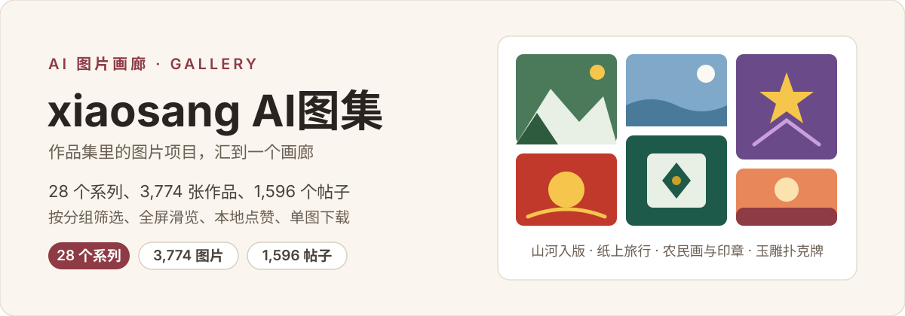
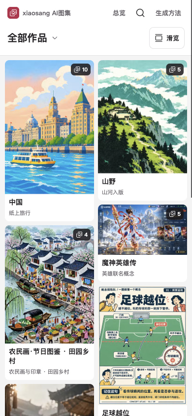

<p align="right"><a href="README.md">中文</a></p>

<p align="center">
  
</p>

<p align="center">
  <a href="https://gallery.xiaosang.cc/">▶ Browse Online</a>
  ·
  <a href="https://github.com/holynova/xiaosang-gallery">GitHub Repository</a>
</p>

xiaosang Gallery gathers the portfolio's scattered image projects into one gallery: 22 collections, 3,666 images, 1,488 posts. Filter by group, swipe through full-screen artwork, save local favorites, download individual files — each collection also ships a copyable prompt template and a generation skill.

## Screenshot

<p align="center">
  
</p>

## Features

- **22 collections**: grouped by source project, with group filters under each collection title; see `overview.html` on the site for the full overview.
- **Post browsing**: sets of works are organized as posts, up to 20 images each; open a post to swipe between posts vertically and images horizontally (323 multi-image posts).
- **Fullscreen swipe**: tap an image to view it fullscreen, swipe to the next.
- **Local favorites**: likes are saved per image, on your device.
- **Single-image downloads**: original or published files are only fetched when you click download (1,532 verified originals, 2,134 files kept byte-identical to the source release).
- **Prompt templates & skills**: each collection has a generation guide (`skills/`, 22 skill packages) with a copyable prompt template.
- **Load on demand**: the homepage pre-renders static above-the-fold posts; the post index, per-collection lists, search, and in-group image data each load on demand.

## Collections

| Collection | Images | Posts | Collection | Images | Posts |
| --- | ---: | ---: | --- | ---: | ---: |
| 山河入版 (Mountains in Print — multi-color woodcut) | 185 | 22 | 撕标签 · Wander (Tearing Labels · Wander) | 137 | 8 |
| 纸上旅行 (Paper Travels — paper-textured gouache) | 60 | 7 | 画风图谱 (Style Atlas) | 369 | 27 |
| 农民画与印章 (Folk Paintings & Seals) | 321 | 44 | 上海穿墙图册 (Shanghai Through Walls) | 9 | 1 |
| 英雄联名概念 (Hero Crossover Concepts) | 205 | 38 | 印刷图鉴 (Print Atlas) | 25 | 8 |
| 知识漫画 (Knowledge Comics) | 121 | 121 | 游戏画风转译 (Game Style Transfer) | 48 | 3 |
| 听见画面 (Hearing Pictures) | 60 | 60 | 课本插画 (Textbook Illustrations) | 209 | 109 |
| 半透明玩具卫士 (Translucent Toy Guardians) | 20 | 3 | 导演与机车 (Directors & Motorcycles) | 100 | 7 |
| 游戏真人化 (Games in Live Action) | 67 | 6 | AI 图片画廊 (AI Image Gallery) | 951 | 951 |
| 创世纪变奏 (Creation Variations) | 40 | 6 | 文物数字图鉴 (Cultural Relics Atlas) | 195 | 13 |
| 橡胶戳艺术 (Rubber Stamp Art) | 350 | 22 | 玉雕扑克牌 (Jade Poker Cards) | 108 | 22 |
| 城市印记 (City Stamps) | 40 | 4 | City Pop 城市画册 (City Pop Album) | 46 | 6 |

Counts come from the source sites' work data; page icons, screenshots, and thumbnail derivatives are not double-counted. The podcast-comics series is not among these 22 collections.

Cloudflare Pages builds `main` with `npm run build:pages` and publishes `dist`. A separate Cloudflare Pages static site serves the archived media. New media ships with each Git build. Add images to `additions/<series ID>/`; each filename becomes its title. See [Cloudflare setup](docs/cloudflare.md).

## Run Locally

Open `index.html` directly, or serve it statically:

```bash
python3 -m http.server 8780 --bind 127.0.0.1
# Open http://127.0.0.1:8780/
```

Update the data (requires Pillow and curl; image and migration-cache directories are git-ignored):

```bash
python3 scripts/migrate_full.py scripts/inventory.json
python3 scripts/build_site.py
python3 scripts/build_skills.py
npm run build     # generates dist/
npm run preview   # previews dist/
```

[Migration manifest & local asset requirements](docs/catalog.md) · [Loading benchmarks & optimization](PERFORMANCE.md)

## Tech

- Zero frameworks: vanilla HTML/CSS/JavaScript + masonry layout (`src/masonry.js`).
- Sharded data: each collection's image data is split into several `data/<collection>-N.js` files, loaded on demand; original or published images 5.64 GiB, AVIF/WebP display layer 2.07 GiB.
- Icons use Lucide Static 1.73.0 (see `vendor/lucide.LICENSE`).

```
index.html          Gallery homepage
overview.html       Collection overview
gallery.js/css      Gallery logic and styles
src/masonry.js      Masonry layout
data/               Per-collection image data (loaded on demand)
scripts/            Migration, site build, skill generation, performance measurement
skills/             Generation skill packages for the 22 collections
```
