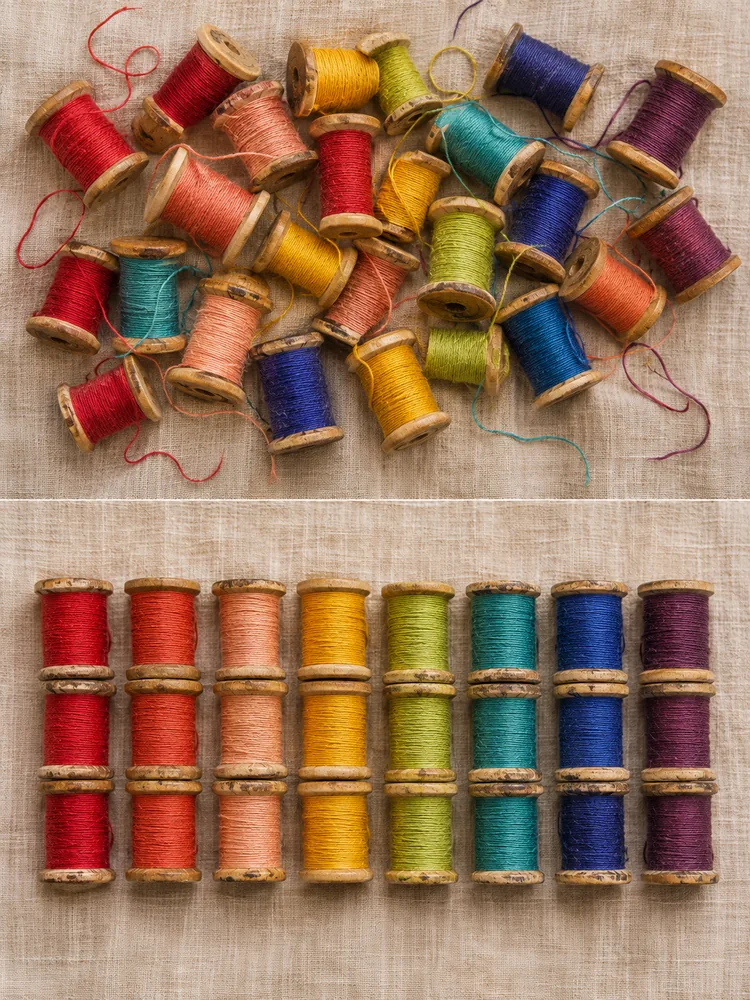

# Color Arrangements

[中文](README.zh-CN.md) · [Open the collection](https://gallery.xiaosang.cc/?series=color-arrangements) · [All 10 originals](../../../additions/color-arrangements/)

Objects are arranged by hue. Look across boats, thread spools and autumn leaves to see how the same organizing principle changes a scene.

Open an image to swipe between works, save a favorite on this device or download its full-size PNG.
